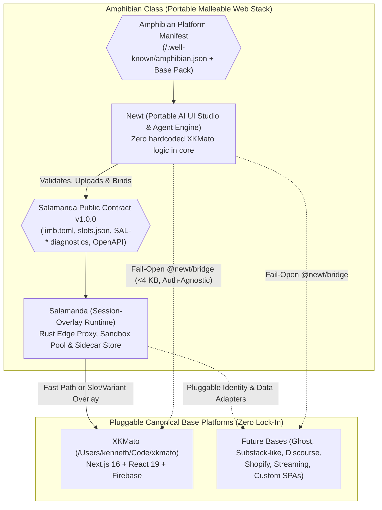
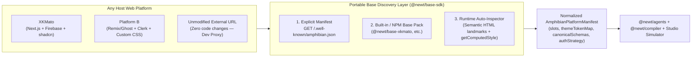
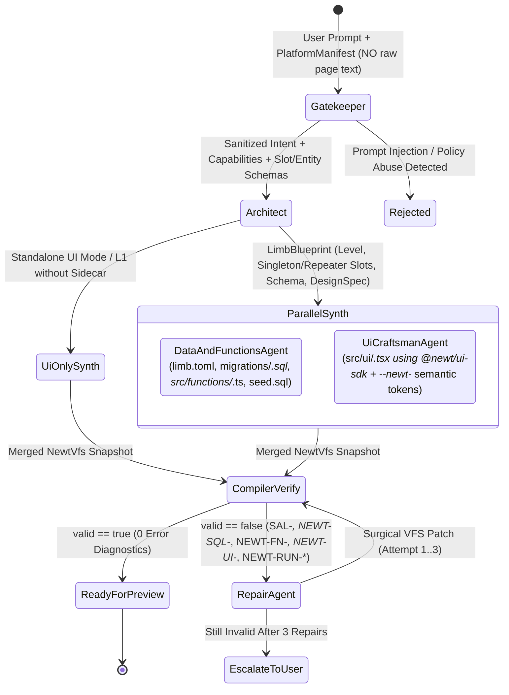
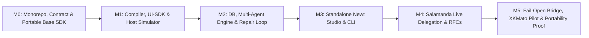

# Newt: Architecture & Execution Plan (v2 — Portable Platform Spec & XKMato Ground-Truth Alignment)

> **Class:** Amphibian (`Class Amphibia` — alongside **[Salamanda](https://github.com/xkmato/salamanda)**)
> **Role:** Standalone, Platform-Agnostic AI-Agentic UI & Limb Studio + Fail-Open In-App Builder
> **First Base Target:** **[XKMato](https://xkmato.com)** (`/Users/kenneth/Code/xkmato` — Next.js 16.1.6, React 19.2.3, React Compiler, Tailwind v4 + shadcn/ui `oklch`, Firebase Auth & Firestore)
> **Runtime Contract:** Salamanda Public Contract `v1.0.0` + Portable `/.well-known/amphibian.json` Host Discovery Spec

---

## 0. Executive Summary & The Amphibian Taxonomy

The **[Amphibian vision](https://xkmato.com/s/rlelxi77)** transforms any web publication or application from static creator-controlled software into a **malleable, user-extensible living platform** (*"Build for your own consumption taste — like a salamander regrowing a new limb"*). Readers can prompt custom UIs and mini-apps right where content lives, keep them private, share them with friends, or monetize them via the host platform's native ledger—while starting on **XKMato** and remaining **portable to any web platform on the internet**.



---

## 1. Key Findings From Auditing `/Users/kenneth/Code/xkmato` (And Resulting Plan Adjustments)

Auditing the real XKMato repository surfaced **seven concrete architectural realities** that directly sharpen both XKMato's readiness and Newt's cross-platform portability:

| # | Finding in `/Users/kenneth/Code/xkmato` | Impact If Unaddressed | Architectural Solution (XKMato + Portable Newt v2) |
| :--- | :--- | :--- | :--- |
| **F1** | **Firestore RBAC Gap (`firestore.rules`):** Rules currently check `isAuthenticated()` (`request.auth != null`) rather than `request.auth.token.role == 'author'` for `subscribers` read/delete, `blogposts`/`microposts` create, `siteconfig` write, and analytics reads (because previously only the author logged in). | Opening reader sign-in + Salamanda user-scoped Firebase tokens would let any signed-in reader or Limb read subscriber emails or write canonical posts! | **P0 XKMato Security Hardening:** Split `isAuthorRole()` (`request.auth.token.role == 'author'`) from `isAuthenticated()` in `firestore.rules`, and list `subscribers`, `pageViews`, `postViews`, `analyticsEvents`, `postAnalytics` in `salamanda.toml` `sensitive_collections`. |
| **F2** | **Client-Only Firebase Auth (`useAuth.tsx`):** Auth tokens live only in browser `IndexedDB` (`firebase/auth`); no `__session` cookie is set. Also `firebase.json` uses Firebase Hosting `frameworksBackend`, which strips all cookies except `__session`. | Browser `GET /blog/[slug]` HTML navigations carry no cookie, so Salamanda's Edge Proxy would see every logged-in reader as `anonymous` on SSR! | **Dual-Mode Auth Resolution:** 1) Add `/api/auth/session` in XKMato to sync an `HttpOnly` `__session` cookie on `onIdTokenChanged`. 2) For **portability to cookie-less SPAs**, upgrade `@newt/bridge` + Salamanda loader to also support client-side Bearer-token slot hydration via `window.NewtHost.getAuthToken()`. |
| **F3** | **Next.js `16.1.6` + React `19.2.3` + `reactCompiler: true` (`layout.tsx`, `next.config.ts`):** App Router hydrates `<html>`/`<body>` directly—there is **no** `<div id="__next">` wrapper. | Injecting light-DOM `<div>`/`<iframe>` nodes into a React-owned `<div>` before hydration finishes causes React 19 hydration mismatches or DOM wiping. | **Shadow-DOM Custom Element (`<amphibian-slot>`):** Mount Limbs inside an open `ShadowRoot` on `<amphibian-slot data-salamanda-slot="...">`. React 19 never reconciles inside `shadowRoot`, eliminating hydration bugs and Tailwind v4 (`* { @apply border-border }`) CSS bleed across **all** frameworks (React, Vue, Svelte, vanilla). |
| **F4** | **Client-Fetched & Infinite-Scroll Repeater Lists (`FeedList.tsx`, `LatestContent.tsx`, `MicropostCard.tsx`):** `/feed` and `/` render microposts client-side after mount and append items dynamically via `IntersectionObserver`. | Static `DOMContentLoaded`/`pushState` slot loaders miss dynamically fetched cards, and singleton mount IDs break per-card slots (`micropost.footer`). | **Repeater Slots + `MutationObserver`:** Add `cardinality: "singleton" \| "repeater"` to the Slot spec and use a `requestAnimationFrame`-batched `MutationObserver` keyed by `(limbId, slotId, itemId)` so Limbs can mount on every `MicropostCard` or `BlogCard` as the user scrolls. |
| **F5** | **Single-Column Essay Layout (`blog/[slug]/page.tsx`):** `BlogPostPage` is a centered `max-w-[720px]` column with no `<aside>` sidebar. | Adding a permanent empty sidebar column would ruin XKMato's clean Substack-inspired centering when Newt/Salamanda aren't active. | **Pure CSS `:has()` Progressive Grid:** Use `lg:has-[amphibian-slot[data-salamanda-mounted]]:grid-cols-[minmax(0,720px)_340px]`. Remains 100% centered `720px` by default; smoothly expands to a 2-column companion rail only when a `blog.sidebar` Limb is mounted. |
| **F6** | **Actual Routes, TipTap Content & Collections (`types/index.ts`, `BlogRenderer.tsx`):** Routes are `/`, `/blog`, `/blog/[slug]`, `/feed`; collections are `blogposts` (TipTap HTML `content` + `plainTextPreview`), `microposts`, `comments`, `siteconfig`. | Hardcoding `/post/*` or `posts` in Newt would mismatch XKMato's real routes and Firestore collections. | **Data-Driven `AmphibianPlatformManifest`:** `@newt/base-xkmato` encodes XKMato's exact routes, `BlogPost`/`Micropost` JSON schemas, and TipTap fixtures, while `@newt/agents` reads schemas dynamically from **any** platform's manifest. |
| **F7** | **Tailwind v4 + `shadcn/ui` `oklch(...)` Theme (`globals.css`):** XKMato uses `next-themes` (`.dark` class on `<html>`) with `--background`, `--foreground`, `--card`, `--primary`, `--muted`, `--border`, `--radius`. | Hardcoding `--bg-card` or hex colors would clash with host themes on XKMato and other platforms. | **Semantic Portable Theme Bridge (`--newt-*`):** `@newt/ui-sdk` styles against semantic `--newt-*` variables mapped from any host's `tokenMap` (or auto-sampled via `getComputedStyle(document.documentElement)` on unknown sites!). |

---

## 2. Recommendations for `/Users/kenneth/Code/xkmato` (Zero-Lock-In Base Readiness)

Every recommended change in `/Users/kenneth/Code/xkmato` obeys one strict rule: **`xkmato` imports zero `@newt/*` NPM packages, builds independently, and behaves 100% identically to today if both Newt and Salamanda are turned off or deleted.**

### 2.1 Priority 0 — Security & Reader Auth Readiness (Required Before Multi-User Pilot)

1. **Harden [firestore.rules](file:///Users/kenneth/Code/xkmato/firestore.rules) for Reader Accounts & Scoped Limb Tokens:**
   *(Delegate authoring to `firestore-rules-author` when implementing.)*
   - Add `function isSiteAuthor() { return request.auth != null && request.auth.token.role == 'author'; }`.
   - Change `blogposts` and `microposts` `allow create` from `isAuthenticated()` to `isSiteAuthor()`.
   - Change `subscribers` `allow read, update, delete` from `isAuthenticated()` to `isSiteAuthor()`.
   - Change `comments` `allow update, delete` and `siteconfig` `allow write` from `isAuthenticated()` to `isSiteAuthor()`.
   - Change `pageViews`, `postViews`, `analyticsEvents`, and `postAnalytics` `allow read` from `isAuthenticated()` to `isSiteAuthor()`.
   - *Result:* Signed-in readers (`role: "reader"`) and Salamanda's user-scoped Firebase tokens can read public `blogposts`, `microposts`, `comments`, and `siteconfig`, while `subscribers` and author mutations are cryptographically locked down.

2. **Add Firebase `__session` Cookie Sync for SSR Edge Routing:**
   - **New file `src/app/api/auth/session/route.ts`:**
     - `POST`: Verifies client `idToken` via `adminAuth.verifyIdToken(idToken)` and sets `__session` cookie (`HttpOnly; Secure; SameSite=Lax; Path=/`). *(Using `adminAuth.createSessionCookie(idToken, { expiresIn: 5 * 24 * 60 * 60 * 1000 })` gives a 5-day SSR session cookie that survives Firebase Hosting's CDN cookie filter.)*
     - `DELETE`: Clears `__session`.
   - **Update [src/hooks/useAuth.tsx](file:///Users/kenneth/Code/xkmato/src/hooks/useAuth.tsx):** Switch `onAuthStateChanged` to `onIdTokenChanged(auth, ...)` so sign-in/refresh calls `POST /api/auth/session` and `signOut` calls `DELETE /api/auth/session`.
   - **Update [src/components/auth/LoginForm.tsx](file:///Users/kenneth/Code/xkmato/src/components/auth/LoginForm.tsx):** Allow reader account creation (`createUserWithEmailAndPassword` toggle alongside existing `signInWithGoogle`, which already creates `"reader"` accounts automatically).

3. **Add Lightweight Health Endpoint (`src/app/api/health/route.ts`):**
   - `GET /api/health` returning `200 OK` `{ ok: true, base: "xkmato", version: "0.1.0" }` for Salamanda upstream & L3 variant health checks.

### 2.2 Priority 1 — Hydration-Safe `<AmphibianSlot>` & Layout Mount Points (~60 Lines Total)

1. **Create Zero-Dependency `src/components/shared/AmphibianSlot.tsx`:**
   ```tsx
   // Renders a 0px inert custom element in vanilla Next.js; mounts Limbs inside Shadow DOM when Salamanda or Newt is active.
   interface AmphibianSlotProps {
     id: string;
     context?: Record<string, string | number | undefined>;
     className?: string;
   }

   export function AmphibianSlot({ id, context, className }: AmphibianSlotProps) {
     const dataAttrs: Record<string, string> = {};
     if (context) {
       for (const [k, v] of Object.entries(context)) {
         if (v !== undefined && v !== "") dataAttrs[`data-${k}`] = String(v);
       }
     }
     return (
       // @ts-expect-error Custom element is framework-agnostic and hydration-immune
       <amphibian-slot
         data-salamanda-slot={id}
         {...dataAttrs}
         class={className}
         suppressHydrationWarning
       />
     );
   }
   ```

2. **Place Inert `<AmphibianSlot>` Anchors in 5 XKMato Views:**
   - **[src/app/(public)/blog/[slug]/page.tsx](file:///Users/kenneth/Code/xkmato/src/app/(public)/blog/[slug]/page.tsx):**
     - `blog.header` right above `<BlogRenderer content={post.content} />` with `context={{ "post-id": post.id, "post-slug": post.slug, "author-id": post.authorId, "reading-time": post.readingTime }}` *(ideal for Luganda TTS, audio summaries, bionic reading)*.
     - `blog.footer` between `<ShareButtons />` and `<SubscribeForm />` with `context={{ "post-id": post.id, "post-slug": post.slug }}` *(ideal for quizzes, citation tools, backlinks)*.
     - `blog.sidebar` in a progressive CSS `:has()` sibling rail alongside the `720px` article container *(0px hidden when unmounted; `340px` sticky desktop sidebar when mounted — ideal for prediction markets, margin notes, study cards)*.
   - **[src/app/(public)/blog/page.tsx](file:///Users/kenneth/Code/xkmato/src/app/(public)/blog/page.tsx):** `blog.list.header` above `<BlogList />` *(topic lenses, custom reading queue)*.
   - **[src/app/(public)/feed/page.tsx](file:///Users/kenneth/Code/xkmato/src/app/(public)/feed/page.tsx):** `feed.header` above `<FeedList />` and `feed.footer` below `<FeedList />`.
   - **[src/components/feed/MicropostCard.tsx](file:///Users/kenneth/Code/xkmato/src/components/feed/MicropostCard.tsx):** Repeater slot `micropost.footer` at the bottom of `<article>` with `context={{ "post-id": post.id, "author-id": post.authorId }}` *(per-micropost reactions, micro-polls, translations, voice playback!)*.
   - **[src/app/ page.tsx](file:///Users/kenneth/Code/xkmato/src/app/page.tsx) & [src/app/layout.tsx](file:///Users/kenneth/Code/xkmato/src/app/layout.tsx):** `home.hero.after` below the hero section, and `shell.dock` before `</body>` *(ambient floating tools)*.

### 2.3 Priority 2 — Declarative Manifests & Fail-Open `<NewtBridge />` (~45 Lines)

1. **Drop `salamanda.toml`, `slots.json`, and `public/.well-known/amphibian.json` into `/Users/kenneth/Code/xkmato`:**
   - Inert config files that allow **both** `salamanda` and **Newt** (or any future Amphibian tool) to auto-discover XKMato's routes, slots, `shadcn` CSS variable map, and public `BlogPost` / `Micropost` / `Comment` schemas.
2. **Add Optional Fail-Open `src/components/shared/NewtBridge.tsx` in [src/app/layout.tsx](file:///Users/kenneth/Code/xkmato/src/app/layout.tsx):**
   - Checks `process.env.NEXT_PUBLIC_NEWT_URL`. If unset -> returns `null` (`0 B` network cost).
   - If set -> registers `window.NewtHost = { baseId: "xkmato", getAuthToken: getIdToken }` (reusing `useAuth().getIdToken` already in `src/hooks/useAuth.tsx`!) and loads `${NEXT_PUBLIC_NEWT_URL}/bridge.js` via `async defer` inside `requestIdleCallback` with a silent `onerror` no-op.
   - Optional UX polish in **[Header.tsx](file:///Users/kenneth/Code/xkmato/src/components/layout/Header.tsx):** Listen for `newt:ready` to show a `"✦ Customize XKmato"` item inside the user's avatar `DropdownMenu` (stays completely invisible if Newt is offline or disabled).

---

## 3. Platform Portability Architecture in Newt (`@newt/base-sdk`)

To ensure Newt is **never** coupled to XKMato and can plug into any third-party platform (Ghost, Substack-style blogs, Discourse forums, Shopify storefronts, streaming apps, or internal SaaS dashboards), Newt introduces the **Portable Base Protocol**:



### 3.1 The Portable `/.well-known/amphibian.json` Specification

Any platform becomes "Newt-Ready" by serving a single static JSON manifest (or selecting a Base Pack in Newt Studio):

```json
{
  "$schema": "https://amphibian.dev/schemas/v1/platform-manifest.schema.json",
  "contract_version": "1.0.0",
  "base": {
    "id": "xkmato",
    "name": "XKmato",
    "framework": "nextjs-app-router",
    "origin": "https://xkmato.com"
  },
  "runtime": {
    "salamanda_capabilities_url": "/_salamanda/capabilities",
    "supports_client_only_hydration": true
  },
  "auth": {
    "strategy": "host-token-callback",
    "ssr_cookie": "__session"
  },
  "theme": {
    "dark_mode_selector": "html.dark",
    "tokens": {
      "--newt-bg": "--background",
      "--newt-card": "--card",
      "--newt-fg": "--foreground",
      "--newt-muted": "--muted-foreground",
      "--newt-primary": "--primary",
      "--newt-primary-fg": "--primary-foreground",
      "--newt-accent": "--accent",
      "--newt-border": "--border",
      "--newt-radius": "--radius"
    }
  },
  "slots": [
    {
      "id": "blog.header",
      "cardinality": "singleton",
      "routes": ["/blog/*"],
      "description": "Mounted above long-form article HTML body.",
      "context_props": {
        "post-id": "string",
        "post-slug": "string",
        "author-id": "string",
        "reading-time": "number"
      }
    },
    {
      "id": "micropost.footer",
      "cardinality": "repeater",
      "routes": ["/feed", "/"],
      "description": "Mounted inside each MicropostCard in infinite-scroll feeds.",
      "context_props": {
        "post-id": "string",
        "author-id": "string"
      }
    }
  ],
  "canonical_entities": {
    "blogposts": {
      "description": "Long-form articles authored in TipTap HTML.",
      "fields": {
        "id": "string",
        "title": "string",
        "slug": "string",
        "subtitle": "string",
        "content": "html_string",
        "plainTextPreview": "string",
        "tags": "string[]",
        "readingTime": "number",
        "authorId": "string",
        "authorName": "string"
      }
    },
    "microposts": {
      "description": "Short text updates with up to 4 S3 images.",
      "fields": {
        "id": "string",
        "text": "string",
        "images": "string[]",
        "authorId": "string",
        "authorName": "string"
      }
    }
  }
}
```

### 3.2 Three Portability Guarantees Built Into Newt Core
1. **Auth-Vendor Agnostic `@newt/bridge`:** `@newt/bridge` never imports `firebase/*`. It calls `await window.NewtHost?.getAuthToken()`—which works identically with Firebase (`xkmato`), Clerk, Supabase Auth, Auth0, NextAuth, or static dev tokens.
2. **Framework & Hydration Agnostic Shadow-DOM Mounting:** Mounting inside `<amphibian-slot>`'s `ShadowRoot` works identically on Next.js 16 + React Compiler, Nuxt/Vue, SvelteKit, Astro, Rails/Hotwire, WordPress, or static HTML.
3. **Zero-Config Semantic Auto-Discovery Mode:** In Standalone Newt Studio, a user can paste *any* URL that has not even adopted `amphibian.json` yet; `@newt/base-sdk` extracts computed CSS colors/fonts (`getComputedStyle`) and semantic landmarks (`<article>`, `<main>`, `<aside>`, `<header>`) to synthesize a working virtual Base Profile for rapid prototyping.

---

## 4. Updated Monorepo & Component Architecture (`/Users/kenneth/Code/newt`)

```text
newt/
├── ARCHITECTURE.md                  # Canonical v2 architecture & execution plan
├── package.json
├── pnpm-workspace.yaml
├── turbo.json
├── tsconfig.base.json
├── .github/workflows/ci.yml
│
├── packages/
│   ├── contract/                    # @newt/contract: Salamanda v1.0.0 schemas, offline SAL-* validator, SalamandaControlPlaneClient
│   ├── base-sdk/                    # @newt/base-sdk: Portable AmphibianPlatformManifest spec, /.well-known loader, CSS token mapper & URL auto-inspector
│   ├── base-xkmato/                 # @newt/base-xkmato: First Base Pack (exact XKMato routes, BlogPost/Micropost schemas, oklch shadcn tokens, TipTap fixtures, XKMato integration kit)
│   ├── ui-sdk/                      # @newt/ui-sdk (<3 KB gzipped): Semantic --newt-* theme bindings, useSlotContext (singleton + repeater), sidecar/canonical/limb RPCs, ResizeObserver
│   ├── compiler/                    # @newt/compiler: esbuild TSX->srcdoc bundler, sql.js migration verifier, L2 TS guard & @host emitter, JSDOM smoke runner
│   ├── agents/                      # @newt/agents: Platform-agnostic Gatekeeper, ArchitectAgent, DataAndFunctionsAgent, UiCraftsmanAgent, RepairAgent (conditioned dynamically via @newt/base-sdk)
│   ├── bridge/                      # @newt/bridge (<4 KB gzipped, zero deps): Fail-open Shadow-DOM <amphibian-slot> mounter, MutationObserver for infinite-scroll repeaters, Slot Picker, MessageChannel host
│   ├── db/                          # @newt/db: SQLite WAL store (Drizzle + better-sqlite3) for projects, VFS checkpoints, threads, deployments & gallery
│   └── cli/                         # newt CLI: `newt init`, `newt studio`, `newt dev`, `newt build`, `newt validate`, `newt inspect-url`, `newt doctor`
│
├── apps/
│   └── studio/                      # @newt/studio: Next.js Standalone Studio + /embed Drawer + /gallery + /api/v1/* Daemon
│
└── examples/
    ├── standalone-widgets/          # Pure UI components (no base platform needed)
    ├── generic-blog-demo/           # Minimal 50-line vanilla HTML/Express site proving cross-platform portability!
    └── xkmato-limbs/                # Reference XKMato Limbs (luganda-tts-blog-header, micropost-voice-note, blog-sidebar-prediction-poll)
```

---

## 5. Multi-Agent Engine, Compiler & Security Architecture

### 5.1 Multi-Agent Synthesis Conditioned on `AmphibianPlatformManifest`



- **Default Model Provider (`NEWT-DECISION-001`):** **Google Gemini (`@google/genai`)** is the default out-of-the-box LLM provider for all Newt agents, behind the pluggable `LlmProvider` interface (which also supports Anthropic, OpenAI, and local Ollama/OpenAI-compatible endpoints).
- **Extension Level Rollout (`NEWT-DECISION-002`):** Newt v1 Studio enables **Level 1 (Declarative Slots + Sidecar)** and **Level 2 (Sandboxed Functions + Egress)** by default, keeping **Level 3 (Source Patch Variants)** gated behind `NEWT_ENABLE_L3_VARIANTS` until opened in **Task 6.1**.
- **Dynamic Entity & Slot Conditioning:** Neither `ArchitectAgent` nor `UiCraftsmanAgent` contains hardcoded strings like `"xkmato"` or `"blogposts"`. Instead, `@newt/base-sdk` injects the active platform's `slots[]` (including `cardinality: "singleton" | "repeater"` so repeater UIs stay compact `<48px` toolbars while sidebar UIs render rich cards) and `canonical_entities` schemas (`BlogPost` with TipTap HTML `content` vs `Micropost` with `text` & `images[]`).
- **6-Stage Deterministic Compiler (`@newt/compiler`):**
  1. `limb.schema.json` + offline `SAL-*` policy check + live Salamanda `POST /v1/limbs:validate`.
  2. In-memory `sql.js` WebAssembly SQLite dry-run on `migrations/*.sql` + `fixtures/seed.sql` (blocking `ATTACH` / `PRAGMA`).
  3. L2 TypeScript AST static guard (`process.env`, `require(`, `eval(`, `Deno.`, `new Function(`) + Salamanda `v1.0` `// @host:` pipeline verification.
  4. In-memory `esbuild` compilation of Preact + `@newt/ui-sdk` + `--newt-*` CSS fallback tokens into a single self-contained `srcdoc` HTML bundle (`< 150 KB`, strict inline CSP).
  5. Headless JSDOM smoke mount verifying `#root` renders cleanly with zero runtime exceptions under both `singleton` and `repeater` slot contexts.
  6. Deterministic Egress Diff Gate (`NEWT-CONSENT-001`) requiring an explicit human click before binding any Limb with external `permissions.egress`.

### 5.2 Upstream Salamanda `v1.1` Contract RFCs (`docs/salamanda-rfcs/`)

While `@newt/bridge` handles these capabilities immediately on the client, Newt will contribute three small, backward-compatible `v1.1` RFCs to `xkmato/salamanda` so bound Limbs enjoy identical capabilities even when Newt is completely turned off:
- **RFC-0001 (`salamanda-overlay`):** Upgrade `CLIENT_LOADER_JS` to support `<amphibian-slot>` Shadow DOM mounting, `MutationObserver` repeater slots (`querySelectorAll` keyed by item context), `salamanda.context.request.v1` (passing `data-*` props + theme variables into `srcdoc`), and bounded `salamanda.resize.v1` height updates.
- **RFC-0002 (`salamanda-overlay` + `salamanda-proxy`):** Add `LimbInvoke` to `BrokerRpcRequest` (`/_salamanda/broker`) so `origin: null` `srcdoc` iframes can invoke their `/_limb/<id>/*` L2 functions with same-origin `__session` / Bearer credentials.
- **RFC-0003 (`salamanda-identity`):** Add Firebase Session Cookie JWKS preset (`https://session.firebase.google.com/<project-id>`) alongside Firebase ID Token JWKS (`https://securetoken.google.com/<project-id>`) + client Bearer-token slot manifest fetch (`POST /_salamanda/slots-for-principal`) for cookie-less SPAs.

---

## 6. Phased Implementation Roadmap & Specific Tasks (`M0` – `M5`)



### Milestone 0: Workspace Foundation, Salamanda Contract & Portable Base SDK
- [x] **Task 0.1 — Initialize `/Users/kenneth/Code/newt` Monorepo:**
  Configure `git`, `pnpm-workspace.yaml`, `turbo.json`, `tsconfig.base.json`, Biome/ESLint, Vitest, and `.github/workflows/ci.yml`.
  *Accept:* `pnpm build`, `pnpm typecheck`, and `pnpm test` pass in `<5s`.
- [x] **Task 0.2 — `@newt/contract` (Salamanda v1.0.0 Schemas, Offline `SAL-*` Validator & SDK):**
  Sync Salamanda `v1.0.0` schemas, implement lossless TOML parse/serialize (`smol-toml`), implement 100% parity TypeScript `validateLimbManifest()` reproducing all `SAL-*` diagnostics, and extend `SalamandaControlPlaneClient`.
  *Accept:* Passes conformance tests on all `xkmato/salamanda` sample limbs and reproduces every `SAL-*` error code.
- [x] **Task 0.3 — `@newt/base-sdk` (Portable `AmphibianPlatformManifest` Specification & Loader):**
  Define `platform-manifest.schema.json` (`/.well-known/amphibian.json`), semantic `--newt-*` CSS variable mapper, `singleton` vs `repeater` slot model, canonical entity schema formatter for LLM prompts, and zero-config HTML/CSS auto-inspector for external URLs.
  *Accept:* Unit tests validate manifests for two distinct platforms (Next.js/Firebase + Express/Vanilla) and generate valid Salamanda `BaseSpec` + `SlotsManifest` artifacts from each.
- [x] **Task 0.4 — `@newt/base-xkmato` (Ground-Truth XKMato Base Pack & Integration Kit):**
  Encode `/Users/kenneth/Code/xkmato`'s exact routes (`/`, `/blog`, `/blog/*`, `/feed`), 9 slots (`blog.header`, `blog.sidebar`, `blog.footer`, `blog.list.header`, `feed.header`, `feed.footer`, repeater `micropost.footer`, `home.hero.after`, `shell.dock`), `shadcn` `oklch` light/dark tokens (`globals.css`), `BlogPost` (TipTap HTML) & `Micropost` schemas/fixtures, and ready-to-copy XKMato integration files (`AmphibianSlot.tsx`, `NewtBridge.tsx`, `/api/auth/session`, `/api/health`, `salamanda.toml`, `slots.json`).
  *Accept:* Validates cleanly against `@newt/contract` and `@newt/base-sdk`.

### Milestone 1: `@newt/ui-sdk`, Deterministic Limb Compiler & Browser Host Simulator
- [x] **Task 1.1 — `@newt/ui-sdk` Portable Client Runtime (`< 3 KB` gzipped):**
  Implement `useSlotContext` (supporting both singleton and repeater `data-*` props), `usePlatformTheme` (`--newt-*` semantic CSS variables), `useSidecarQuery`, `executeSidecar`, `readCanonical`, `invokeLimbFunction` (broker-proxied for `origin: null` iframes), and `autoResizeFrame`.
  *Accept:* Bundle `< 3 KB` gzipped; unit tests pass for RPC correlation, timeouts, theme updates, and resize clamping.
- [x] **Task 1.2 — `@newt/compiler` Single-File `srcdoc` Bundler:**
  Build in-memory `esbuild` pipeline compiling `src/ui/*.tsx` + Preact + `@newt/ui-sdk` + mapped host fallback tokens into self-contained `ui/*.html` bundles with strict inline CSP and `< 150 KB` size budget (`NEWT-UI-*`).
  *Accept:* TSX component compiles in `<100ms` into one standalone HTML string with zero external script/style URLs.
- [x] **Task 1.3 — `@newt/compiler` Wasm SQLite Dry-Runner & L2 Handler Lowering:**
  Validate `migrations/*.sql` in `sql.js` (`NEWT-SQL-*`, blocking `ATTACH`/`PRAGMA`) and verify/emit L2 `functions/*.ts` against Salamanda `v1.0`'s `transpile_and_guard_ts` + `// @host:` rules (`NEWT-FN-*`).
  *Accept:* Rejects `process.env`/`eval(` escapes and bad SQL; compiles L2 poll and TTS handlers cleanly.
- [x] **Task 1.4 — Headless JSDOM Smoke Runner & Multi-Platform `MockSalamandaHostBroker`:**
  Build Stage 5 JSDOM mount smoke verifier (`NEWT-RUN-*`) and in-browser `MockSalamandaHostBroker` (`sql.js` + any `AmphibianPlatformManifest`'s fixtures) supporting both singleton and infinite-scroll repeater slots.
  *Accept:* Automated test compiles a repeater `micropost.footer` Limb and a singleton `blog.sidebar` Limb, mounts both against `MockSalamandaHostBroker`, and verifies independent SQLite state per `post-id`.

### Milestone 2: Persistence (`@newt/db`) & Platform-Agnostic Multi-Agent Engine (`@newt/agents`)
- [x] **Task 2.1 — `@newt/db` SQLite WAL Store & Checkpoint VFS:**
  Implement zero-ops SQLite WAL (`node:sqlite`) schema (`projects`, `vfs_snapshots`, `threads`, `messages`, `deployments`, `gallery_listings`, `entitlement_grants`) with immutable checkpoints, snapshot diffs, and 1-click rollback.
  *Accept:* WAL durability across reopen, diff generation, entitlement checks, and rollback tests pass.
- [x] **Task 2.2 — `LlmProvider` Abstraction & Prompt-Injection `Gatekeeper`:**
  Implement Gemini (`@google/genai`, default), Anthropic, OpenAI, and Ollama adapters + data-fenced `Gatekeeper` + toxic permission pre-check.
  *Accept:* Adversarial prompt-injection fixtures attempting private `data_read` + `egress` are blocked or gated.
- [x] **Task 2.3 — `ArchitectAgent`, `DataAndFunctionsAgent`, & `UiCraftsmanAgent`:**
  Implement manifest-driven `LimbBlueprint` planning and parallel code synthesis conditioned purely on the active `AmphibianPlatformManifest` + Salamanda `llms.txt`.
  *Accept:* Generates valid Limbs across **two different Base Packs** (`@newt/base-xkmato` AND `indie-forum`) without changing a single line in `@newt/agents`.
- [x] **Task 2.4 — Bounded `RepairAgent` Self-Correction Loop:**
  Feed 6-stage `Diagnostic[]` (`SAL-*` + `NEWT-*`) into `RepairAgent` (max 3 surgical retries).
  *Accept:* Seeded manifest, SQL, L2 guard, and TSX errors self-repair to `valid == true` in `<= 2` iterations.

### Milestone 3: Standalone Newt Studio (`apps/studio`) & `newt` CLI
- [x] **Task 3.1 — Newt Daemon API & SSE Streaming Routes (`apps/studio/app/api/v1/*`):**
  Implement `/health`, `/bases`, `/projects`, `/projects/:id/files`, `/projects/:id/rollback`, and streaming SSE `/projects/:id/chat`.
  *Accept:* Integration tests verify SSE event ordering, manual code edits, and checkpoint restores.
- [x] **Task 3.2 — Standalone Studio UI with Pluggable Base Shell Simulator:**
  Build the split-pane Studio: Agent Chat & Trace, **Pluggable Base Simulator** (renders faithful XKMato `/`, `/blog`, `/blog/[slug]` TipTap article + progressive `:has()` sidebar, and `/feed` infinite-scroll `MicropostCard`s, OR any custom `AmphibianPlatformManifest` / isolated component canvas!), Code/Diff Editor, `sql.js` Sidecar Explorer, and Contract/Security Inspector.
  *Accept:* Playwright E2E test builds both a standalone UI widget and an XKMato `blog.sidebar` Limb in Studio, toggling `.dark` mode and inspecting live SQLite rows.
- [x] **Task 3.3 — `newt` Standalone CLI (`packages/cli`):**
  Implement `newt init`, `newt studio`, `newt dev`, `newt build`, `newt validate`, `newt inspect-url <url>` (bootstraps a Base Pack from any live site), and `newt doctor`.
  *Accept:* `pnpm newt build` produces a Limb directory passing `salamanda validate`.

### Milestone 4: Live Salamanda Control Plane Integration & Upstream RFCs
- [x] **Task 4.1 — Salamanda `ClientDelegationAuth` Deployment Pipeline:**
  Implement `/api/v1/projects/:id/deploy`, `/publish`, and `/api/v1/bindings/me` using server-held `X-Salamanda-Client-Id/Key` + delegated user token and Human Egress Consent gating (`NEWT-CONSENT-001`).
  *Accept:* E2E test against the real Rust `salamanda` daemon (`:8080` + `:7474`) compiles, uploads, and binds a Limb for `uid:kenneth` while `uid:alice` stays on the vanilla fast path.
- [x] **Task 4.2 — Upstream Salamanda `v1.1` RFCs (`RFC-0001`, `RFC-0002`, `RFC-0003`):**
  Author ready-to-merge RFCs and reference patches for Shadow-DOM repeater slots, `LimbInvoke` broker proxying, and Firebase Session Cookie / SPA Bearer hydration.
  *Accept:* RFCs and consumer-driven contract tests committed and verified.

### Milestone 5: Auth-Agnostic `@newt/bridge`, XKMato Integration & Cross-Platform Portability Proof
- [x] **Task 5.1 — `@newt/bridge` (`< 4 KB` Fail-Open Shadow-DOM Bridge & `MutationObserver`):**
  Implement `<amphibian-slot>` Shadow-DOM mounter, `MutationObserver` repeater hydration, visual Slot Picker overlay, `window.NewtHost.getAuthToken()` pluggable auth handoff over `MessageChannel` (`newt.host.v1`), and `2.5s` fail-open timeout.
  *Accept:* Resilience E2E tests confirm killing Newt (`503` / `ECONNREFUSED` / timeout) produces **zero** console errors, **zero** React 19 hydration warnings, and **zero** CLS on Next.js 16 + `reactCompiler: true`.
- [x] **Task 5.2 — Embedded Drawer (`apps/studio/app/embed`), Gallery & Entitlement Gate:**
  Implement `/embed` drawer, `/gallery`, Permission Consent Cards, and pluggable `EntitlementVerifier` webhook (supporting XKMato ledger/subscriptions or any third-party platform's billing webhook).
  *Accept:* End-to-end flow: prompt in `/embed` -> ephemeral inline preview -> activate on Salamanda -> stop Newt server -> verify Limb continues running via Salamanda alone.
- [x] **Task 5.3 — Second-Platform Portability Proof (`examples/generic-blog-demo`) & Optional XKMato PR:**
  Mount the **exact same `@newt/bridge` + Newt Studio** onto both a non-Next.js `examples/generic-blog-demo` app and `/Users/kenneth/Code/xkmato` (applying the P0–P2 XKMato recommendations immediately alongside M0).
  *Accept:* E2E suite proves Newt authors and mounts working Limbs on two completely different web stacks/auth providers without modifying a single line of Newt core.

### Milestone 6 (Open Gate — Ready When Triggered): Level 3 Full-Source Variant Authoring
- [x] **Task 6.1 — Open the Level 3 (`level = 3`) Variant Gate in `@newt/agents`, `@newt/compiler`, & Studio UI:**
  Flip `NEWT_ENABLE_L3_VARIANTS` when a base advertises `3` in `GET /v1/capabilities` (`allow_levels`):
  1. Enable `VariantPatchAgent` to synthesize minimal unified git diffs (`patches/variant.patch`) with `sha256` digests and `touches` lists in `[patch]`.
  2. Enforce pre-flight `edit_allow` / `edit_deny` verification (`SAL-EDIT-001` — blocking `.env*`, `firestore.rules`, `firebase.json`, `salamanda.toml`).
  3. Add Studio **Patch Diff Review**, async worktree/container build progress streaming (`Materializing -> Building -> Running`), and **Rebase Conflict Resolution UI** when upstream Base commits mark a Variant `Stale`.
  *Accept:* E2E test generates a Level 3 layout patch against a local Git base repo, passes `SAL-EDIT-001` checks, materializes via `salamanda-variants`, and gracefully falls back + prompts self-repair upon a simulated upstream rebase conflict.
